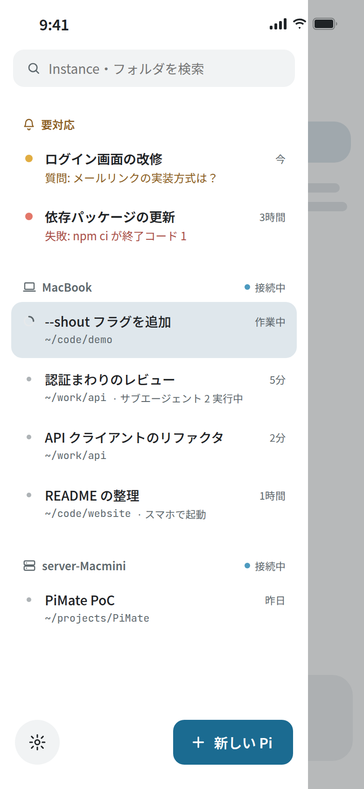
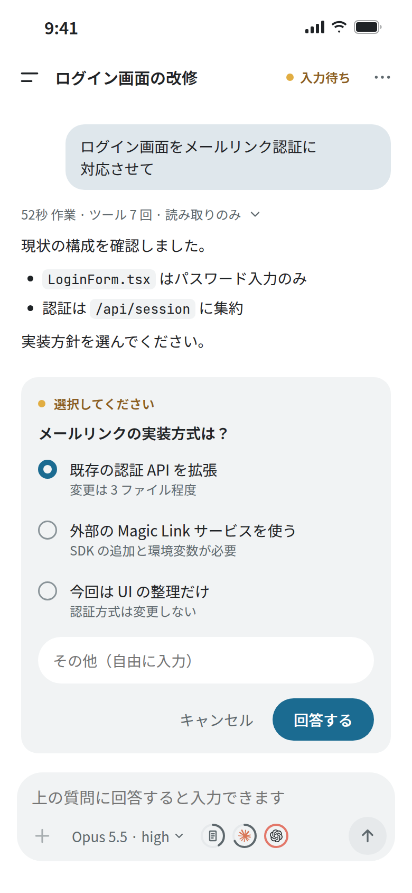
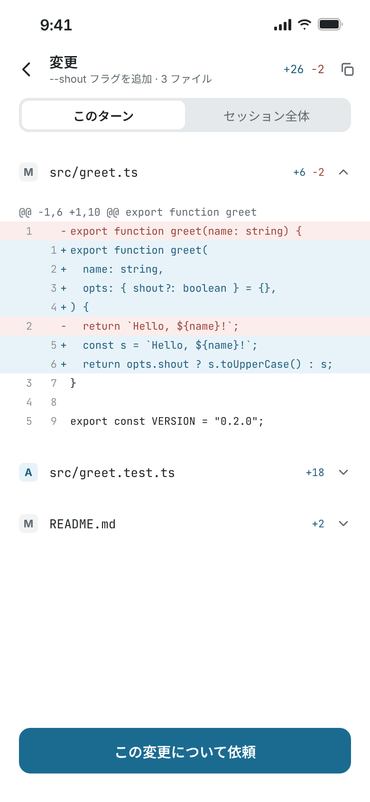
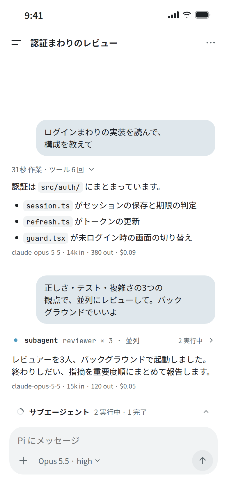

# PiMate

English | [日本語](README.md)

PiMate lets you use the [Pi Coding Agent](https://github.com/earendil-works/pi) running on your PC from a phone app. It does not mirror the terminal; it gives you a chat UI built for phones that controls the same Pi.

- **Continue PC work on your phone** — start `pi` on your PC as usual, then watch it and send instructions from your phone.
- **Continue phone work on your PC** — start a new Pi on your PC from your phone, and attach to it later from a PC terminal (`pimate attach`).
- **Manage several Pis** — Pis across multiple PCs and folders appear in one list, with the ones waiting for input grouped at the top.
- **Resilient to disconnects** — switching apps or losing the network does not stop the Pi on your PC; reconnecting brings you back to its current state.

Pi itself is not modified. Conversation history, settings and credentials stay with the Pi on your PC.

<p>
  
  
  
  
</p>

<sub>Images are design mockups; details may differ from the actual app. The app UI is in Japanese.</sub>

## Features

- **Chat**: streaming replies, Markdown (tables, code, links), partial text selection and copy, image attachments (up to 4) and an image viewer. Messages sent while Pi is working are steered in right away.
- **Answer Pi's questions**: confirm / select / input requests appear as cards in the chat. Whichever of PC or phone answers first wins.
- **Review changes**: per-turn or whole-session diffs of changed files, with "ask about this change".
- **Model and Thinking**: switching, favorites, saving defaults for new Pis. Gauges show context usage and Claude / Codex quota.
- **Session actions**: new session, open past sessions, fork, compact, session tree, `/` command suggestions.
- **Subagents**: list of running children, their work log, stop and steer (pi-subagents and others).
- **Start a new Pi**: pick the PC, folder, model and first message from your phone.
- **Notifications**: waiting-for-input, finished and failed events (only while the app is connected to the PC).
- **Provider login**: log in to / out of OpenAI, Anthropic and OpenCode from the app.
- **Read GitHub Issues / PRs**: open Issues and PRs of the Pi's repository (uses `gh` on the PC).
- **Update PiMate on the PC**: from the app's settings, if the Host runs as a service.

## Requirements

| | Requirement |
|---|---|
| PC | Linux x64 (tested). Linux arm64 is built but untested. macOS lacks service registration; Windows is not supported. |
| PC software | Node.js 22+, Pi 1.2.0+ |
| Phone | Android 7.0+ (in practice Android 8.0+, required by the Tailscale app). No iOS build is distributed. |
| Network | PC and phone on the same [Tailscale](https://tailscale.com/) account |
| Optional | [GitHub CLI](https://cli.github.com/) on the PC (after `gh auth login`) for Issues / PRs |

## Getting started

### 1. Install PiMate on your PC

```sh
pi install npm:@phni3j9a/pimate
pi
```

### 2. Run the setup in Pi

In the Pi you just started, run:

```
/pimate setup
```

This starts the PC-side server (the Host) and shows a QR code for pairing. You will be asked two things:

- **Start the Host automatically at login?** (systemd user service `pimate-host.service`). If you decline, the Host still runs for now and keeps running after you close Pi.
- **Make the `pimate` command available?** A link is created in e.g. `~/.local/bin`. If that directory is not on your PATH, the line to add is shown (your shell config is not edited).

### 3. Install the app on your phone

Download `pimate-….apk` from the **`PiMate Android …` (tag `app-v…`)** release on [GitHub Releases](https://github.com/phni3j9a/PiMate/releases) and install it. If Android asks, allow "install unknown apps" for the browser or file app you used (you can revoke it afterwards).

### 4. Pair

Tap "QR コードを読み取る" (Scan QR code) in the app and scan the QR shown on your PC. Confirm the machine name and address, and you are done.

- The code is valid for **10 minutes, once**. If it expires, run `/pimate pair` in Pi to show a new one.
- The app's first screen also walks you through the Tailscale and PC preparation.

From now on, any `pi` you start on the PC appears in the app's list. You can also start a Pi on the PC from the app ("新しい Pi を起動").

## PC commands

Inside Pi:

| Command | Description |
|---|---|
| `/pimate setup` | Initial setup (can be re-run) |
| `/pimate pair` | Show a new pairing QR (also for adding another phone) |
| `/pimate devices` | List and revoke paired devices |
| `/pimate status` | Show versions, listen addresses, service status, etc. |
| `/pimate start` / `stop` / `restart` | Start / stop / restart the Host (Pi sessions keep running) |
| `/pimate uninstall` | Prepare for removal (see below) |

In a terminal (if you enabled the `pimate` command during setup):

```sh
pimate attach                    # list Pis started from the phone
pimate attach pimate-01234567    # attach to that Pi from the PC (Ctrl+\ to detach)
```

The app's session menu shows the `attach` command for each Pi.

## Updating

**App**: the "情報" (About) section in settings checks for a new version. Installing a newer APK from Releases updates the app in place.

**PiMate on the PC**:

- If the Host runs as a service, update from the app: **Settings → Machine → PC の PiMate → Update** (the Host restarts automatically).
- Otherwise, on the PC run:

  ```sh
  pi update npm:@phni3j9a/pimate
  ```

  then run `/pimate restart` in Pi.

Running Pis are not updated automatically. To use new features, run `/reload` in each Pi or restart it. Some features need both the app and the PC package updated. See [CHANGELOG.md](CHANGELOG.md) (Japanese) for per-version changes.

## Uninstalling

1. Run `/pimate uninstall` in Pi on the PC (stops the Host and removes the autostart service and the `pimate` link that PiMate created).
2. Run `pi remove npm:@phni3j9a/pimate` in a terminal.
3. To also forget pairings, delete `~/.config/pimate`.

## Security notes

- **Pairing gives the phone control over Pi on your PC.** Do not share the QR code or pairing link (`pimate://…`). New pairings can only be started from Pi on the PC.
- The Host listens only on the PC itself (loopback) and its Tailscale address. Without Tailscale, only the PC itself can connect.
- Do not open untrusted `pimate://` links. A library used by the app has a known issue where a malformed URL can make it unresponsive ([#85](https://github.com/phni3j9a/PiMate/issues/85)).
- Notifications arrive only while the app is connected to the PC. They stop when the app is closed or suspended by the OS ([details](docs/notifications.md), Japanese).
- Screens that only work on the PC (e.g. custom UI of some extensions) show a `pimate attach` hint in the app.

## More

The following documents are in Japanese.

- [App features in detail](apps/mobile/README.md)
- [PC package (Host and `pimate` CLI)](packages/pimate/README.md)
- [Provider login](docs/provider-auth.md)
- [Notifications](docs/notifications.md)
- [Subagents](docs/subagents.md)
- [Drive Pi on your PC from Grok Bot (optional)](packages/pimate/README.md#grok-bot-skills任意) — start by adding the **[PiMate](https://x.ai/bot/EL8LzPmNquZTjEawTxAI1)** template
- [Changelog](CHANGELOG.md)
- Bug reports and requests: [Issues](https://github.com/phni3j9a/PiMate/issues)
- For contributors: [CONTRIBUTING.md](CONTRIBUTING.md)

## License and trademarks

[MIT License](LICENSE)

Claude is a trademark of Anthropic, PBC. OpenAI, Codex and the OpenAI logo are trademarks of OpenAI. The app uses each company's logo unmodified solely to indicate which provider a quota belongs to; this does not imply any affiliation or endorsement.
