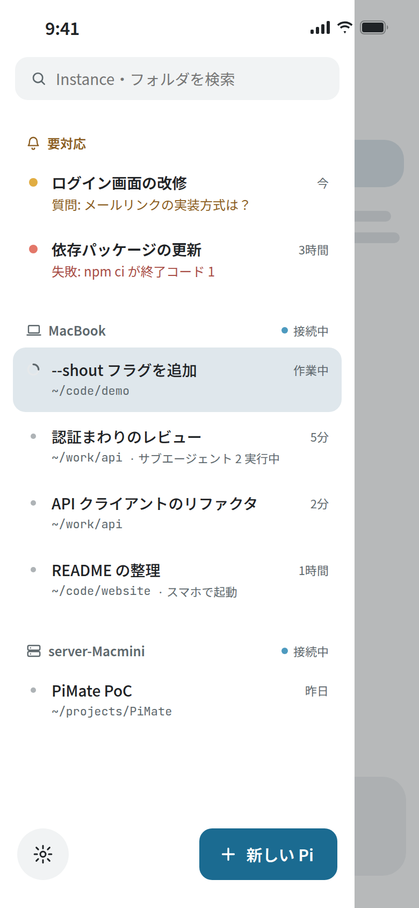
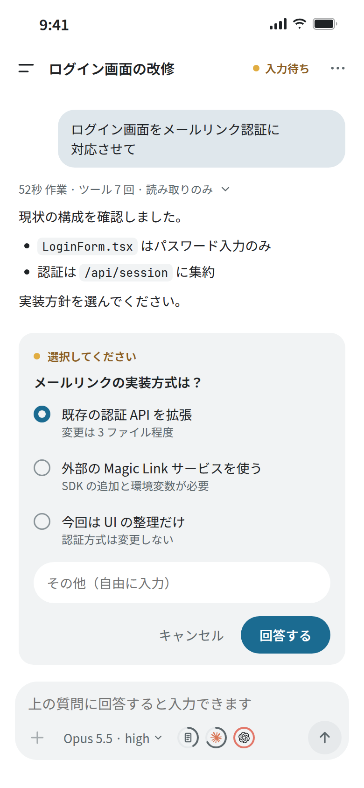
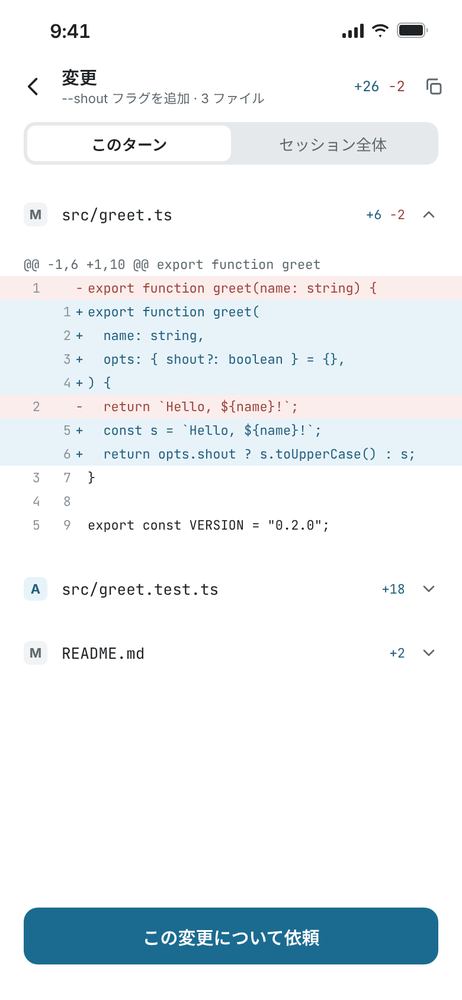
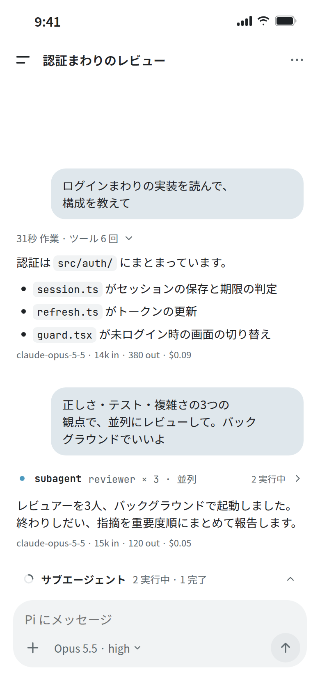

# PiMate

[English](README.en.md) | 日本語

PC で動いている [Pi Coding Agent](https://github.com/earendil-works/pi) を、スマホのアプリから使うためのツールです。ターミナル画面を遠隔表示するのではなく、スマホ向けのチャット画面で同じ Pi を操作します。

- **PC で始めた作業をスマホで続ける** — PC で普段どおり `pi` を起動すれば、その Pi をスマホから見て、指示を送れます。
- **スマホで始めた作業を PC で続ける** — スマホから PC 上に新しい Pi を起動し、あとで PC のターミナルからつなげます（`pimate attach`）。
- **複数の Pi をまとめて管理** — 複数の PC・フォルダの Pi を一覧にし、入力待ちの Pi を上にまとめて表示します。
- **切断に強い** — アプリの切り替えや回線断があっても PC の Pi は止まらず、再接続すると今の状態に戻ります。

Pi 本体は改造しません。会話の履歴・設定・認証は PC の Pi のものをそのまま使います。

<p>
  
  
  
  
</p>

<sub>画像はデザインのモックです。実際のアプリとは細部が異なることがあります。</sub>

## できること

- **チャット**: 回答の逐次表示、Markdown（表・コード・リンク）、部分選択してコピー、画像の添付（最大4枚）と閲覧。作業中に送ると、その場で指示を割り込ませます。
- **Pi からの質問に回答**: 確認・選択・入力の要求がチャット内のカードに出ます。PC とスマホの先に答えた方が使われます。
- **変更の確認**: ファイルの変更をターンごと・セッション全体で差分表示し、「この変更について依頼」できます。
- **モデルと Thinking**: 切り替え、お気に入り、新しい Pi の既定の保存。コンテキストと Claude / Codex の利用枠をゲージで表示します。
- **セッション操作**: 新しいセッション、過去のセッションを開く、分岐、圧縮、セッションツリー、`/` コマンドの候補。
- **サブエージェント**: 実行中の子の一覧・作業記録・停止・割り込み（pi-subagents など）。
- **新しい Pi を起動**: PC・フォルダ・モデル・最初のメッセージを選んでスマホから起動します。
- **通知**: 入力待ち・完了・失敗をスマホに通知します（アプリが PC とつながっている間だけ）。
- **プロバイダーのログイン**: OpenAI・Anthropic・OpenCode へのログイン／ログアウトをアプリから行えます。
- **GitHub の Issue / PR を読む**: その Pi のリポジトリの Open な Issue と PR を表示します（PC の `gh` を使用）。
- **PC の PiMate の更新**: 常駐させた Host なら、アプリの設定から更新できます。

## 必要なもの

| | 条件 |
|---|---|
| PC | Linux x64（動作確認済み）。Linux arm64 はビルドのみで未確認です。macOS は常駐登録に未対応、Windows は非対応です。 |
| PC のソフト | Node.js 22 以上、Pi 1.2.0 以上 |
| スマホ | Android 7.0 以上（Tailscale アプリの都合で、実際は Android 8.0 以上）。iOS 版は配布していません。 |
| ネットワーク | PC とスマホを、同じアカウントの [Tailscale](https://tailscale.com/) につなぐ |
| 任意 | GitHub の Issue / PR 表示には、PC に [GitHub CLI](https://cli.github.com/)（`gh auth login` 済み） |

## はじめかた

### 1. PC に PiMate を入れる

```sh
pi install npm:@phni3j9a/pimate
pi
```

### 2. Pi で初回セットアップ

起動した Pi で次を実行します。

```
/pimate setup
```

PC 側の待ち受け（Host）が起動し、ペアリング用の QR コードが表示されます。途中で次の2つを聞かれます。

- **ログイン時に Host を自動起動するか**（systemd のユーザーサービス `pimate-host.service`）。断った場合も Host は今回だけ起動し、Pi を閉じても動き続けます。
- **`pimate` コマンドを使えるようにするか**。`~/.local/bin` などにリンクを作ります。PATH に入っていない場合は追加する行を表示します（シェルの設定ファイルは書き換えません）。

### 3. スマホにアプリを入れる

[GitHub Releases](https://github.com/phni3j9a/PiMate/releases) の **`PiMate Android …`（タグ `app-v…`）** から `pimate-….apk` をダウンロードしてインストールします。「不明なアプリのインストール」の許可を求められたら、ダウンロードに使ったブラウザ／ファイルアプリに許可してください（インストール後に戻して構いません）。

### 4. ペアリング

アプリの「QR コードを読み取る」で、PC に表示された QR を読み取ります。マシン名とアドレスを確認すれば完了です。

- QR のコードは **10分間・1回限り** です。期限が切れたら PC の Pi で `/pimate pair` を実行して出し直します。
- アプリの最初の画面にも、Tailscale と PC 側の準備の手順があります。

あとは PC で `pi` を起動すれば、その Pi がアプリの一覧に出ます。アプリの「新しい Pi を起動」から PC に Pi を立ち上げることもできます。

## PC 側のコマンド

Pi の中で使うコマンドです。

| コマンド | 内容 |
|---|---|
| `/pimate setup` | 初回セットアップ（再実行も可） |
| `/pimate pair` | ペアリング用の QR を出し直す（別のスマホの追加にも） |
| `/pimate devices` | ペアリング済みの端末の一覧と取り消し |
| `/pimate status` | バージョン、接続先、常駐の状態などを表示 |
| `/pimate start` / `stop` / `restart` | Host の起動・停止・再起動（Pi は終了しません） |
| `/pimate uninstall` | 削除の準備（下記） |

ターミナルで使うコマンド（`/pimate setup` で `pimate` コマンドを有効にした場合）:

```sh
pimate attach                    # スマホから起動した Pi の一覧
pimate attach pimate-01234567    # その Pi に PC からつなぐ（Ctrl+\ で離れる）
```

アプリのセッションメニューに、その Pi の `attach` コマンドが表示されます。

## 更新

**アプリ**: 設定の「情報」で新しい版を確認できます。Releases から新しい APK を入れると、上書きで更新されます。

**PC の PiMate**:

- 常駐させた Host なら、アプリの **設定 → マシン → PC の PiMate → 更新** で更新できます（Host は自動で再起動します）。
- それ以外は PC で次を実行します。

  ```sh
  pi update npm:@phni3j9a/pimate
  ```

  そのあと Pi で `/pimate restart` を実行します。

起動中の Pi は自動では更新されません。新しい機能を使うには、各 Pi で `/reload` するか Pi を起動し直してください。新しい機能にはアプリと PC の両方の更新が必要なことがあります。各版の変更は [CHANGELOG.md](CHANGELOG.md) にあります。

## 削除

1. PC の Pi で `/pimate uninstall` を実行します（Host を止め、PiMate が作った自動起動の設定と `pimate` コマンドのリンクを消します）。
2. ターミナルで `pi remove npm:@phni3j9a/pimate` を実行します。
3. ペアリングの情報も消す場合は `~/.config/pimate` を削除します。

## セキュリティと注意

- **ペアリングは、スマホに PC の Pi を操作する権限を与えます。** QR やペアリング用リンク（`pimate://…`）を他人に共有しないでください。新しいペアリングは PC の Pi からしか始められません。
- Host が待ち受けるのは、PC 自身（loopback）と Tailscale のアドレスだけです。Tailscale がない場合は PC 自身からしか接続できません。
- 信頼できない `pimate://` リンクは開かないでください。アプリが使っているライブラリに、不正な URL で応答しなくなる既知の問題があります（[#85](https://github.com/phni3j9a/PiMate/issues/85)）。
- 通知はアプリが PC とつながっている間だけ届きます。アプリを終了したり、OS が休止させたりすると届きません（[詳細](docs/notifications.md)）。
- PC でしか操作できない画面（一部の Extension の独自画面など）は、アプリに `pimate attach` の案内が出ます。

## もっと詳しく

- [アプリの機能の詳細](apps/mobile/README.md)
- [PC パッケージ（Host・`pimate` CLI）の詳細](packages/pimate/README.md)
- [プロバイダーのログイン](docs/provider-auth.md)
- [通知](docs/notifications.md)
- [サブエージェント](docs/subagents.md)
- [Grok Bot から PC の Pi を動かす（任意）](packages/pimate/README.md#grok-bot-skills任意) — テンプレート **[PiMate](https://x.ai/bot/EL8LzPmNquZTjEawTxAI1)** を追加すると始められます
- [変更履歴](CHANGELOG.md)
- 不具合の報告・要望は [Issues](https://github.com/phni3j9a/PiMate/issues) へ
- 開発に参加する方は [CONTRIBUTING.md](CONTRIBUTING.md)

## ライセンス・商標

[MIT License](LICENSE)

Claude は Anthropic, PBC の、OpenAI・Codex・OpenAI のロゴは OpenAI の商標です。アプリでは利用枠がどのプロバイダーのものかを示すためだけに各社のロゴを改変せずに使っており、提携・推薦を意味するものではありません。
