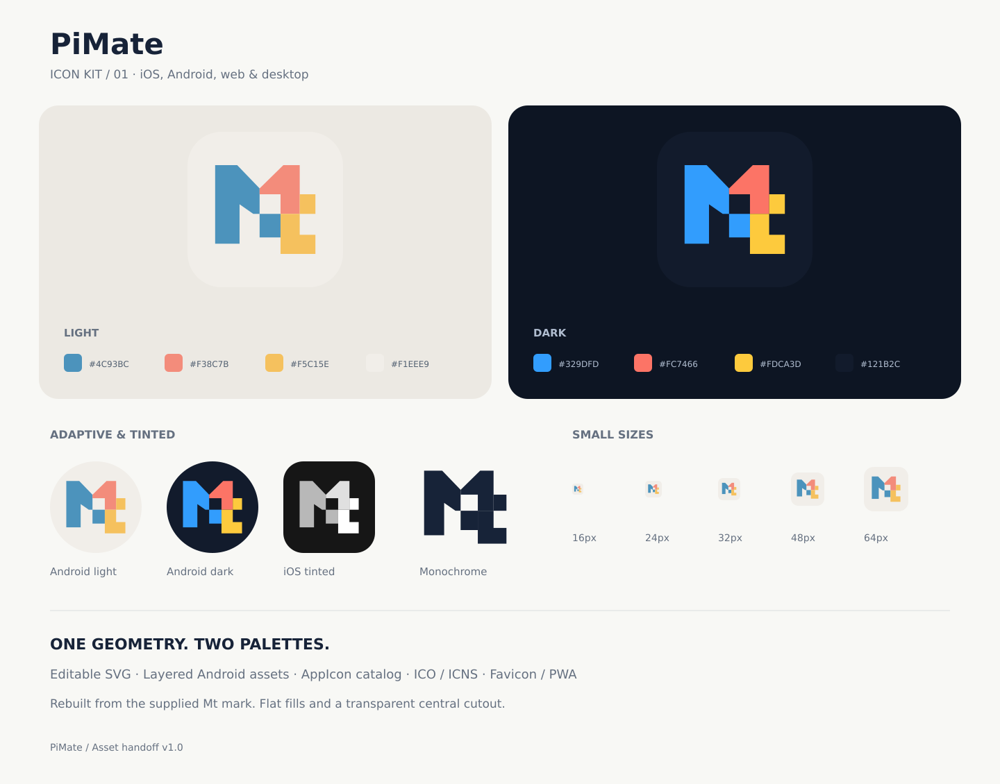

# PiMate icon kit v1.0

添付された `845.png`（ライト）・`846.png`（ダーク）の **Mtマーク**を、アプリの実装に使える素材へ整理したセットです。



## デザイン

- `846.png` の形を元に、直線と多角形でベクターとして再構成しました。2枚には微妙な形状差があるため、ライト／ダークとも同じ形に統一しています。
- ライト版は `845.png`、ダーク版は `846.png` の代表色を採取し、フラットな塗りにしました。元画像のピクセル完全再現ではありません。
- 中央の四角い抜きは透明です。背景の紙質、グリッド、ノイズ、文字列 `PiMate` はランチャーアイコンに含めていません。
- 単色版は同じ輪郭を保ちます。単色では隣り合う色面はつながります。
- `source/geometry.json` が形状・配色の正本です。生成PNGを手で修正せず、正本から再生成してください。

| 用途 | ライト | ダーク |
|---|---|---|
| 青 | `#4C93BC` | `#329DFD` |
| コーラル | `#F38C7B` | `#FC7466` |
| 黄 | `#F5C15E` | `#FDCA3D` |
| 背景 | `#F1EEE9` | `#121B2C` |

## 収録内容

| フォルダ | 内容 |
|---|---|
| `source/` | 編集用SVG（カラー2種／白／黒）、正方形アイコンSVG、形状と色のJSON |
| `logo/` | 1024pxの透過マークPNG（カラー2種／白／黒） |
| `ios/AppIcon.appiconset/` | 1024px PNGのLight／Dark／TintedとXcode用 `Contents.json` |
| `ios/icon-composer-layers/` | 1024座標系で整列済みの3色のSVGレイヤー。両テーマを収録 |
| `android/adaptive/` | 透過前景・不透明背景・白単色前景の1024px PNG、および前景SVG |
| `android/native-light/`, `native-dark/` | Android用VectorDrawable、API 26／33用adaptive-icon XML、密度別legacy PNG |
| `android/play-store-*-512.png` | Play Store提出用512pxの正方形アイコン |
| `android/notification/` | 白いシルエットの透過PNG（24／36／48／72／96px）。通知用途の素材のみ |
| `splash/` | ライト／ダーク背景用の透過マークPNG |
| `web/` | SVG／ICO favicon、16〜512px PNG、192／512px maskableアイコン、manifest雛形 |
| `desktop/` | Windows用ICO、macOS用ICNS・iconset、Linux等用16〜1024px PNG、トレイ用単色PNG |
| `integration/` | PiMate（Expo SDK 57）への導入手順と設定例。素材を作り直したときの再反映にも使う |
| `preview.png`, `preview.svg` | 見た目の確認用シート。丸角・円形の表示はプレビュー用 |
| `manifest.json` | 生成ファイルのサイズ・SHA-256とAndroidの余白検証値 |

## iOS / iPadOS

通常のPNG／Asset Catalog経路で使用できます。1024px画像はRGB・sRGB・アルファチャンネルなしの正方形です。角丸や影は焼き込まず、OS側の処理に任せます。Tintedはグレースケールの元画像で、最終的な着色はOSが行います。

Expoでは `ios.icon` にLight／Dark／TintedのPNGを指定します。PiMateでは組み込み済みです（[#45](https://github.com/phni3j9a/PiMate/issues/45)）。

新しいIcon Composer経路も選べるようにSVGレイヤーを用意しました。ただし、このキットはコンパイル済みの `.icon` ドキュメントを含みません。必要ならXcodeのIcon Composerに各レイヤーを取り込み、背景色とappearanceを設定し、位置を維持して保存してください。PNG／Asset Catalog経路と `.icon` 経路はどちらかを選びます。

## Android

- 前景は108dp換算のキャンバスに配置し、マークの横幅を48dpにしています。全頂点が中央66dp径の安全円内に入り、最大半径は約32.08dpです。
- 前景・背景をそのままレイヤーとして渡します。前景に丸角や円形マスクを追加しないでください。
- 単色前景は透明背景上の白いマークです。対応ランチャーの「テーマアイコン」機能が色を決めます。
- `native-light` と `native-dark` は選択肢です。同じリソース名なので両方を同時にコピーしないでください。**ライト／ダークの通常アイコンがAndroidで自動切替する設定は含みません**。Expo導入例はライト版を標準にします。
- ネイティブAndroidへ直接入れる場合は片方の `res` を対象へマージし、`AndroidManifest.xml` のapplicationで `android:icon="@mipmap/ic_launcher"`、`android:roundIcon="@mipmap/ic_launcher_round"` を指定します。
- ExpoでCNGを使う場合はネイティブの `res` を直接編集せず、設定例を使ってください。

## Web / desktop

`web/head-snippet.html` は配置例です。PWAの `site.webmanifest` は **雛形** なので、公開先の `start_url`、`scope`、アイコンパスを決めてからリンクしてください。maskable版は通常版より余白が広く、マークが中央80%径の安全円に入ります。通常／maskableを別々に指定します。

ICOは16／24／32／48／64／128／256pxを含みます。ICNSとiconsetは16〜1024pxとRetina用サイズを含みます。デスクトップ版は透明な外周の内側に丸角タイルを描画してあります。トレイ／メニューバーには `desktop/tray` の白・黒単色を使ってください。macOSでは利用フレームワーク側でテンプレート画像として指定します。

## 再生成

Node.js 22.18以降を使って、キットのディレクトリで実行します。sharpはこのキットの開発用依存だけで、アプリには追加しません。

```sh
cd docs/design/icon-kit
npm install --ignore-scripts
npm run build
```

SVG・PNG・ICO・ICNS・XML・プレビュー・manifestが生成されます。`README.md` と `integration/` は手書きの導入資料です。生成物と正本は一緒にコミットしてください。

## 検証状況

サイズ、PNGのアルファの有無、Tintedのグレースケール、SVG/XML/JSONの構文、AndroidとPWAの安全領域、ICO／ICNS内の画像を検査し、プレビューも目視確認しています。Xcode・Androidのビルド、実機ランチャー、ストアへの提出はこの素材作成では実行していません。OSやランチャーによる最終的な表示は実装後に確認してください。

## 参照仕様

2026-10-16確認。

- [Expo SDK 57 app config](https://docs.expo.dev/versions/v57.0.0/config/app/)
- [Apple: Configuring your app icon using an asset catalog](https://developer.apple.com/documentation/xcode/configuring-your-app-icon)
- [Apple: Creating your app icon using Icon Composer](https://developer.apple.com/documentation/xcode/creating-your-app-icon-using-icon-composer)
- [Android: Adaptive icons](https://developer.android.com/develop/ui/compose/system/icon_design_adaptive)
- [Web App Manifest: icon masks and safe zone](https://www.w3.org/TR/appmanifest/#icon-masks)
