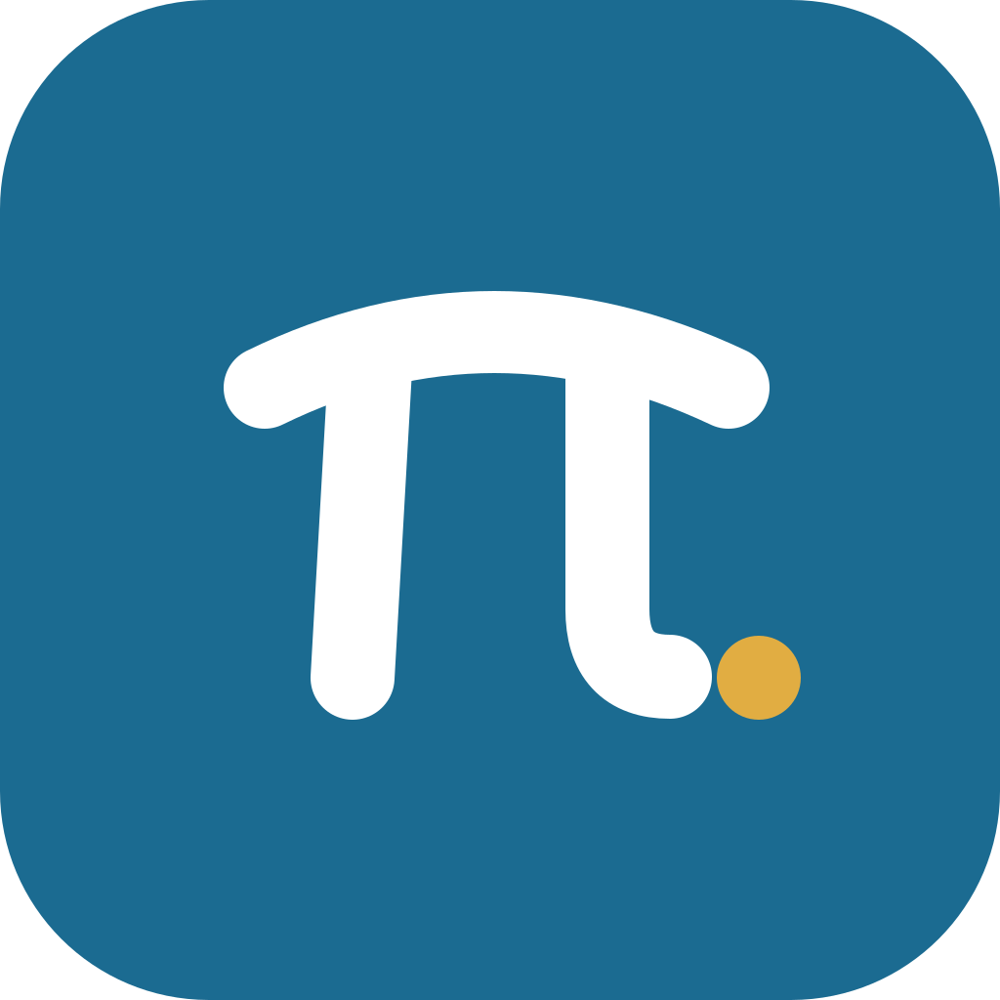

# PiMate — logo concept 01

A minimal companion mark for PiMate, the native mobile interface to the Pi coding agent.

- **Bridge:** The curved top is the Greek letter π, suggesting a connection between the host and phone.
- **Mate:** The separated golden dot represents the companion at the end of that connection.
- **Colors:** Pi Blue `#1B6B91`, Mate Gold `#E1AD42`, Ink `#1F2326`.
- **Sources:** `pimate-app-icon.svg` is full-bleed launcher artwork; `pimate-symbol.svg` has a transparent background; white and monochrome variants support dark themes and Android themed icons; `pimate-wordmark.svg` has letterforms outlined as vector paths; `pimate-icon-rounded.svg` is a marketing preview.

**Status: design proposal only.** Existing Expo app icons, package releases, and screenshots are intentionally unchanged pending design approval. Let iOS/Android apply their native launcher masks to the full-bleed icon. Validate Android adaptive icon safe zones before replacing the existing assets.
